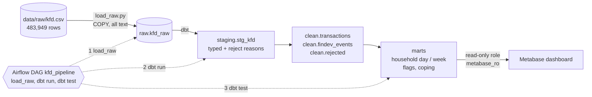

# Kenya Household Cash-Flow Pipeline

An ELT pipeline that turns the messy **Kenya Financial Diaries** transaction file (about 484,000 rows, 298 low-income
households, five regions, 2012 to 2013) into clean, modelled PostgreSQL tables and a Metabase dashboard that
**flags days and weeks where a household's net cash flow drops unusually**, and shows what households did afterwards
(borrow, buy on credit, draw down savings).

**Who it is for:** a financial inclusion analyst or NGO programme manager who needs to spot likely shocks (illness, job
loss, school fees, crop failure) and design more responsive financial products or support. Refreshable on demand and
weekly through Airflow.

Full explanation of every file and every piece of code: **[docs/PROJECT.md](docs/PROJECT.md)**

## Architecture



## What is in the repo

| Path | What it is |
|---|---|
| `load_raw.py` | Lands the raw CSV in Postgres (`raw.kfd_raw`) with `COPY` |
| `kfd_dbt/` | dbt project: staging, clean and mart models, tests, a seed, macros |
| `airflow/` | Dockerised Airflow with the `kfd_pipeline` DAG |
| `metabase/` | Dockerised Metabase and a script that builds the dashboard through its API |
| `analysis.ipynb` | Early exploratory analysis of the raw data |
| `docs/PROJECT.md` | The detailed project document |

## Quick start

Needs Python 3.11, Docker, and a local PostgreSQL with a database named `kfd`.

```bash
python -m venv venv && source venv/bin/activate
pip install -r requirements.txt

# 1. put the raw file at data/raw/kfd.csv, then create .env (never commit it):
#    PGUSER=...  PGPASSWORD=...  PGHOST=localhost  PGPORT=5432  PGDATABASE=kfd

# 2. run by hand
python load_raw.py                      # raw CSV -> raw.kfd_raw
cd kfd_dbt && dbt build                 # seed + staging + clean + marts + all tests

# 3. or run it with Airflow (UI on http://localhost:8080)
cd airflow && docker compose up --build

# 4. dashboard (UI on http://localhost:3000)
cd metabase && docker compose up -d
python metabase/build_dashboard.py      # needs METABASE_API_KEY in .env
```

dbt reads its connection from `kfd_dbt/profiles.yml`, which is not committed. Create it from the example in
[docs/PROJECT.md](docs/PROJECT.md#9-operations-runbook), using `env_var('PGPASSWORD')` for the password.

## The numbers at a glance

| | |
|---|---|
| Raw rows | 483,949 (298 households) |
| Clean transactions | 395,356 (295 households, 5 regions) |
| Clean financial-device events | 61,684 |
| Rejected rows | 521 (zero or missing amount) |
| Flagged household-weeks | 561 of 15,976 |
| Flagged household-days | 2,702 of 109,987 |
| dbt tests | 28 passing |

## Data

Kenya Financial Diaries, collected through bi-weekly interviews with 298 households in Nairobi, Mombasa, Makueni,
Vihiga and Eldoret between 2012 and 2013. The raw file is not in the repository because of its size
(`data/` is git-ignored).
