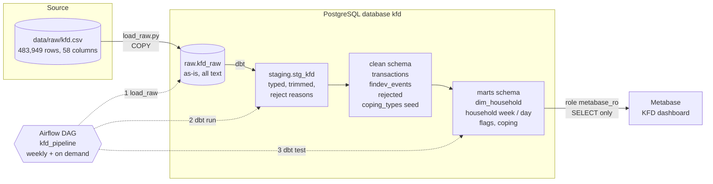
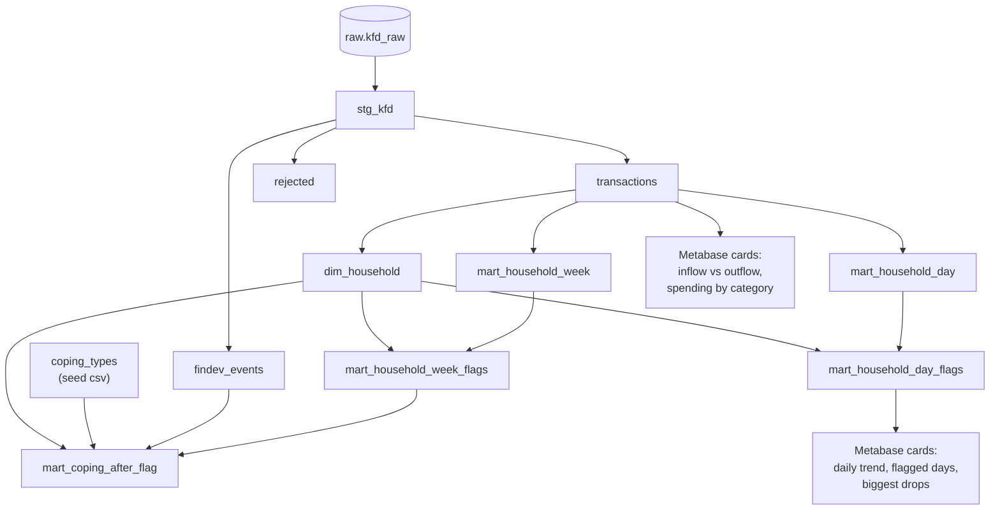
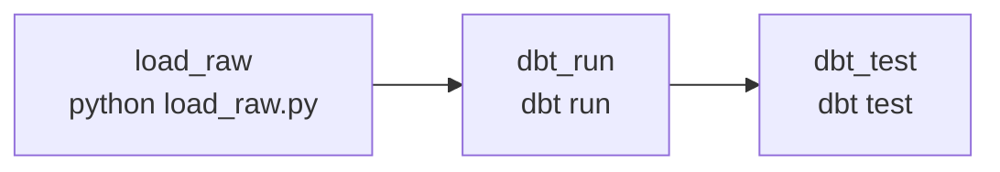

# Kenya Household Cash-Flow Pipeline: Project Document

This document explains what the project is for, how data moves through it, what every file does, and how the code
works. Numbers quoted here were measured on the data as loaded on 2026-11-10.

**Contents**

1. [The problem](#1-the-problem)
2. [Architecture](#2-architecture)
3. [The data](#3-the-data)
4. [Tool choices](#4-tool-choices)
5. [Repository map](#5-repository-map)
6. [Code walkthrough](#6-code-walkthrough)
7. [Data model](#7-data-model)
8. [Data quality rules](#8-data-quality-rules)
9. [Operations runbook](#9-operations-runbook)
10. [Findings](#10-findings)
11. [Gaps and known issues](#11-gaps-and-known-issues)
12. [Next steps](#12-next-steps)
13. [Interview summary](#13-interview-summary)
14. [Appendix: sample SQL](#14-appendix-sample-sql)

---

## 1. The problem

A financial inclusion analyst or NGO programme manager needs a clear view of daily and weekly household cash inflows
and outflows across five Kenyan regions (Nairobi, Mombasa, Makueni, Vihiga, Eldoret). They need to spot days or weeks
where a household's net cash flow drops unusually, so they can investigate possible shocks (illness, job loss, school
fees, agricultural failure), see how households coped afterwards (borrowing, buying on credit, drawing down savings),
and design more responsive financial products or support. The dashboard is refreshable on demand and updated weekly.

**What the pipeline decides for the user:** which households and which days or weeks to look at first.

---

## 2. Architecture

### 2.1 The whole system



Reading the diagram: solid arrows are data moving; dotted arrows are Airflow starting each step. The database holds
four layers, and each layer has one job:

| Layer | Schema | Job | Changes data? |
|---|---|---|---|
| Raw | `raw` | Keep the source file exactly as received, so any cleaning decision can be replayed | No |
| Staging | `staging` | Give every raw row proper types and a reject reason, drop nothing | Types only |
| Clean | `clean` | The trusted tables: in-scope rows that passed every rule, plus the rejected rows | Filters and derives |
| Marts | `marts` | Shapes built for the business question: household-day, household-week, flags, coping | Aggregates |

### 2.2 How the dbt models depend on each other



### 2.3 The Airflow DAG



Each task is one shell command, so a failed step can be re-run on its own from the Airflow UI without redoing the
earlier ones. `dbt_test` has no retries: a failing data test is a finding to look at, not a flaky step.

### 2.4 Why this shape (ELT, not ETL)

The raw file is landed unchanged and every cleaning rule lives in dbt SQL. Three reasons:

1. **Replayable.** If a cleaning rule turns out to be wrong, change the SQL and rebuild. Nobody has to re-read a
   242 MB file.
2. **Testable and visible.** Rules are SQL that dbt tests check on every run, and rejected rows are stored with a
   reason instead of vanishing.
3. **Fast.** The first version cleaned in pandas and took about 13 minutes (a row-by-row hashing step dominated).
   Landing with `COPY` takes about 2 minutes, and dbt builds the whole cleaned layer in about 90 seconds.

**Where it will break first:** the raw load (a changed column name stops it by design) and the region mapping (a new
household prefix is rejected as `unknown_region`). **What struggles at 10x data:** the household-day spine in
`mart_household_day` (it creates a row for every day a household was observed) and the full-history baselines. Both
would move to incremental models.

---

## 3. The data

**Source:** Kenya Financial Diaries, bi-weekly interviews with 298 low-income households in Nairobi, Mombasa,
Makueni, Vihiga and Eldoret, 2012 to 2013. One CSV, 483,949 data rows, 58 columns (59 in the database, which adds
`row_id`).

### 3.1 Profile

| Fact | Value |
|---|---|
| Rows | 483,949 |
| Columns | 58 |
| Households | 298 (295 after removing the KZI households) |
| Date range of clean transactions | 5 Aug 2012 to 31 Dec 2013 |
| Row classes (`trx_class_code`) | opex 283,942, income 114,417, findev 77,070, cash 7,599, assets 921 |
| Null `hh_ids` / `trx_date` | 0 / 0 |
| Null `trx_value_kes` | 519 (0.1%) |
| Null `trx_direction` | 14,912 (3.1%) |
| Null `trx_mode_code` | 7,657 (1.6%) |
| Repeated `trx_id` | 258,164 rows (53%) |
| Largest amount / median / 99th percentile (clean) | 174,000 / 50 / 6,890 KES |
| Clean rows flagged as sharing a natural key | 45,849 of 395,356 (11.6%) |

### 3.2 Top 3 data quality risks

1. **Not every row is a cash flow.** The file mixes real flows (`income`, `opex`) with financial-device events
   (`findev`), and with balance snapshots: "CLOSING BALANCE" rows (mode codes 18 and 19) and `cash`/`assets` rows.
   Summing everything would double count money and bury the signal. *Evidence:* five row classes. The 14,912 rows with
   no direction are 7,163 balance rows, 7,701 financial-device rows and 48 asset rows; none is an `income` or `opex`
   row.
2. **The transaction id is not a key.** 258,164 rows (53%) repeat a `trx_id`, so it cannot identify a row. Among the
   clean rows, 11.6% share the same household, date, type, direction, amount and account, and most of those are
   genuine repeat purchases (for example the same small water purchase twice in a day). Deleting them would remove
   real spending, so they are kept and flagged.
3. **Amounts and groupings are untrustworthy at the edges.** 521 in-scope rows have a missing or zero amount.
   Three households (prefix `KZI`) do not belong to any of the five study regions. Amounts run up to 174,000 KES
   against a median of 50, and the file cannot say which extremes are genuine shocks and which are entry errors.

### 3.3 Columns the business question cannot do without

| Need | Column(s) | Notes |
|---|---|---|
| Household | `hh_ids` | The first 3 letters give the region |
| Date | `trx_date` | Text like `28mar2013`; parsed in staging |
| Amount | `trx_value_kes` | Text; must be numeric and above zero |
| Direction | `trx_direction` | `Inflow` or `Outflow`, from the household's cash perspective |
| Category | `trx_class_code`, `trx_type_code`, `trx_type_desc`, `trx_family_code` | class, then family, then type |
| Region | derived from `hh_ids` | There is no region column |

### 3.4 How the data could change

A second study year or more households would bring new household prefixes (rejected as `unknown_region` until
mapped), possibly new type codes (new coping behaviours would need a line in the seed), a different date format (the
date macro already accepts `29-Jul-13` as well as `29jul2013`, though only the second appears in this file), and more
volume (see 2.4).

---

## 4. Tool choices

| Layer | Chosen | Why | Alternatives considered | Real trade-offs |
|---|---|---|---|---|
| Ingestion | Python script with `psycopg2` and Postgres `COPY` | `COPY` loads 484k rows in about 2 minutes, with one transaction for safe rollback | pandas `to_sql` (took about 7 minutes for the same data), Spark | Not parallel, but the file is 242 MB, so Spark would only add setup |
| Raw storage | Postgres schema `raw` | Keeps the source exactly as received, queryable next to the clean data | Files in cloud storage | One more copy of the data on disk |
| Transformation | dbt (Postgres adapter) | Cleaning is SQL, tested on every run, with lineage between models | pandas scripts (the first version), Polars | Adds a tool to learn; rules must be expressed in SQL |
| Modelled storage | PostgreSQL | Free, close to systems met in real jobs, connects to Metabase | DuckDB (simpler), BigQuery (scales, but costs and adds a platform) | A single machine; fine at this size |
| Orchestration | Airflow in one Docker container | Dependencies between steps, retries, run history, an on-demand button, a weekly schedule | A script plus cron, Prefect | Heavy for one linear job: it is a scheduler, webserver and database in one container with SQLite metadata |
| Dashboard | Metabase (Docker) | Free, connects straight to Postgres, has an API so the dashboard is rebuilt from code | Power BI, Looker Studio | Native-SQL cards are less flexible than a full BI model |
| Version control | Git | History is part of the evidence | n/a | n/a |
| Docs | README plus this document | | | |

Choices that were deliberate: dbt and Airflow run in **separate Python environments** (in the Airflow image dbt lives
in its own virtual environment) so their dependencies cannot clash, and Metabase reads through a **read-only
database role**, so a dashboard user can never change the data.

---

## 5. Repository map

```
kenya-household-cashflow-pipeline/
├── README.md                    project overview and quick start
├── CLAUDE.md                    short guidance file for AI coding assistants working in the repo
├── LICENSE                      licence text
├── requirements.txt             pinned Python dependencies
├── .python-version              Python version (3.11.8)
├── .gitignore                   keeps data/, venv/, .env, logs and caches out of Git
├── .env                         local secrets (NOT in Git)
├── load_raw.py                  step 1: raw CSV -> raw.kfd_raw
├── analysis.ipynb               early exploratory analysis
├── docs/
│   └── PROJECT.md               this document
├── data/                        (not in Git) raw/kfd.csv plus old cleaned outputs
├── kfd_dbt/                     the dbt project
│   ├── dbt_project.yml          project settings, thresholds, schemas
│   ├── profiles.yml             database connection (NOT in Git)
│   ├── macros/
│   │   ├── generate_schema_name.sql   use schema names exactly as configured
│   │   └── parse_kfd_date.sql         date parsing for both formats
│   ├── seeds/coping_types.csv         which financial events count as coping
│   ├── models/
│   │   ├── sources.yml                declares raw.kfd_raw and tests it
│   │   ├── staging/stg_kfd.sql        typing, region, scope, reject reasons
│   │   ├── clean/
│   │   │   ├── transactions.sql       income and spending flows
│   │   │   ├── findev_events.sql      borrowing, lending, savings events
│   │   │   ├── rejected.sql           rows that failed a rule, with the reason
│   │   │   └── schema.yml             tests for the clean tables
│   │   └── marts/
│   │       ├── dim_household.sql
│   │       ├── mart_household_week.sql
│   │       ├── mart_household_week_flags.sql
│   │       ├── mart_household_day.sql
│   │       ├── mart_household_day_flags.sql
│   │       ├── mart_coping_after_flag.sql
│   │       └── schema.yml             tests for the marts
│   ├── tests/ snapshots/ analyses/    empty (dbt created them; .gitkeep only)
│   └── README.md                      dbt starter text, unchanged
├── airflow/
│   ├── Dockerfile               Airflow image plus a separate dbt environment
│   ├── docker-compose.yml       runs Airflow
│   ├── profiles.yml             dbt connection for the container (password from environment)
│   └── dags/kfd_pipeline.py     the DAG
└── metabase/
    ├── docker-compose.yml       runs Metabase
    └── build_dashboard.py       creates the dashboard through Metabase's API
```

Files dbt or Docker generate (`kfd_dbt/target/`, `kfd_dbt/logs/`, `logs/`, `__pycache__/`, `venv/`) are ignored by
Git. `kfd_dbt/.user.yml` and `airflow/.user.yml` are dbt's anonymous usage-tracking ids, not project code.

---

## 6. Code walkthrough

### 6.1 `load_raw.py`: land the raw file

Purpose: copy the source CSV into Postgres unchanged, and refuse to start if the file is wrong.

1. **Read settings.** `load_dotenv()` reads `.env`, so the password is never in code.
2. **Check the file.** It must exist and be non-empty, contain every column in `REQUIRED_COLS` (the 12 the dbt
   staging model reads), and have at least one row. Otherwise the script exits with a clear message. This is the
   "extract" failure handling.
3. **Count the rows.** It counts data rows with Python's `csv` module (so quoted line breaks count once): 483,949.
4. **Rebuild the table inside one transaction.**

```python
with conn, conn.cursor() as cur:            # commit on success, roll back on any error
    cur.execute('CREATE SCHEMA IF NOT EXISTS raw')
    cur.execute('DROP TABLE IF EXISTS raw.kfd_raw CASCADE')
    # row_id = line number in the raw file (COPY inserts in file order)
    cur.execute('CREATE TABLE raw.kfd_raw (row_id bigint GENERATED ALWAYS AS IDENTITY, <58 text columns>)')
    cur.copy_expert("COPY raw.kfd_raw (<columns>) FROM STDIN WITH (FORMAT csv, HEADER true)", f)
    ...
    assert db_rows == file_rows
```

Why it is safe to re-run: it is a **full refresh**. Dropping and recreating happens in the same transaction as the
load, so a failed run leaves the previous table untouched, and a successful run never leaves duplicates
(idempotent). Every column is text on purpose: no value can fail to load because of its type.
`row_id` becomes the stable handle that later tables use to point back at the raw row.

### 6.2 `kfd_dbt/dbt_project.yml`

* **`vars`** hold every business threshold, so none are hard-coded in SQL:

| Var | Value | Meaning |
|---|---|---|
| `thin_week_min_rows` | 10 | A week with fewer rows is `thin` and is never flagged or used in the baseline |
| `flag_k` | 1.5 | Flag when net cash flow is more than this many standard deviations below the household's own mean |
| `min_ok_weeks` | 8 | Weeks of usable data before a household's weekly baseline is trusted |
| `min_ok_days` | 30 | Days with data before a household's daily baseline is trusted |
| `coping_window_days` | 28 | How far after a flagged week to look for coping |

* **`models`** put each folder in its own schema and materialisation: staging and clean are **tables** (queried
  often, expensive to compute), marts are **views** (cheap, always current).
* **`seeds`** load `coping_types.csv` into the `clean` schema, with `trx_type_code` forced to text so it joins to the
  raw (text) type codes.

### 6.3 Macros

* `generate_schema_name.sql` overrides dbt's default, which would name schemas `clean_marts` and so on. With the
  override, a folder configured as `+schema: marts` lands in exactly `marts`.
* `parse_kfd_date.sql` turns text into a date:

```sql
case
    when col ~ '^[0-9]{1,2}[A-Za-z]{3}[0-9]{4}$'   then to_date(col, 'DDMonYYYY')   -- 29jul2013
    when col ~ '^[0-9]{1,2}-[A-Za-z]{3}-[0-9]{2}$' then to_date(col, 'DD-Mon-YY')    -- 29-Jul-13
end
```

Anything that matches neither pattern becomes `null`, and the row is rejected as `bad_date`. In this file every one
of the 483,949 dates uses the first format.

### 6.4 `models/staging/stg_kfd.sql`

One row out for every row in. It never deletes anything; it only adds meaning. In order:

1. **`src`**: trim text, turn empty strings into `null` (`nullif(trim(x), '')`), lower-case the class code,
   standard-case the direction (`initcap(lower(...))` so `inflow`, `INFLOW` and `Inflow` all become `Inflow`).
2. **`typed`**: parse both dates with the macro; convert the amount only if it looks like a number
   (`~ '^-?[0-9]+(\.[0-9]+)?$'`, otherwise `null`, so a bad amount never crashes the build); derive the region from
   the first three letters of `hh_ids` (`KEL` Eldoret, `KMO` Mombasa, `KVI` Vihiga, `KMA` Makueni, `KNB` Nairobi,
   anything else `UNKNOWN`).
3. **`scoped`**: decide `in_scope`. A row is in scope when its household is **not** `KZI` and it is either `income` or
   `opex` (cash flows) or `findev` with a real direction and a mode code other than 18 or 19 (balance rows).
   `cash` and `assets` rows are snapshots, not flows, so they are out of scope.
4. **Final select**: add `reject_reason`, the **first** rule a row breaks:

```sql
case
    when hh_ids is null                           then 'missing_household'
    when trx_date is null                         then 'bad_date'
    when value_kes is null or value_kes <= 0      then 'bad_value'
    when trx_direction not in ('Inflow','Outflow')
         or trx_direction is null                 then 'bad_direction'
    when region = 'UNKNOWN'                       then 'unknown_region'
end as reject_reason
```

Result on the real data: 483,949 rows in, 457,561 in scope, 521 rejected (`bad_value`), 457,040 clean.

**Before and after, one real row:**

| | Raw (`raw.kfd_raw`, row 5) | Clean (`clean.transactions`) |
|---|---|---|
| Household | `KMOMT32` | `KMOMT32` |
| Region | (not present) | `Mombasa` |
| Date | `'28mar2013'` (text) | `2013-03-28` (date) |
| Class | `'opex'` | `opex` |
| Direction | `'Outflow'` | `Outflow` |
| Amount | `'100'` (text) | `100` (numeric) |
| Signed amount | (not present) | `-100` |
| Type | `Pre-paid phone credit and data bundles` | same |
| Key | (`trx_id`, not unique) | `9a15844bf21cad1fb8469e493da2e70a` |
| Duplicate flag | (not present) | `false` |

**A rejected row:** raw row 1709, household `KMOMM13`, class `income`, direction `Inflow`, date `30mar2013`, amount
empty. It lands in `clean.rejected` with `reject_reason = bad_value`. It never reaches `clean.transactions`.

### 6.5 The clean models

**`transactions.sql`** (one row per reported income or spending transaction). It keeps in-scope, passing rows of class
`income` or `opex`, and adds three things:

* `signed_kes`: positive for inflows, negative for outflows, so a sum is a net flow.
* `is_dup_key`: true when another row has the same household, date, class, type, direction, amount and account. Rows
  are flagged, **not** removed, because most are real repeat purchases.
* `trx_key`: a primary key built as `md5(natural key + occurrence number)`. The occurrence number counts the repeats
  (`row_number() over (partition by <natural key> order by row_id)`), so even identical rows get different keys. A
  post-hook then runs `alter table ... add primary key (trx_key)`, so Postgres itself refuses duplicates.

**`findev_events.sql`**: financial-device events (borrowing, lending, savings, mobile money, insurance). Same
cleaning, plus `signed_kes`. Balance snapshots were already excluded in staging. 61,684 rows.

**`rejected.sql`**: every in-scope row that failed a rule, with the raw date and amount text and the reason.
Nothing is silently lost. 521 rows.

### 6.6 The coping seed: `seeds/coping_types.csv`

A twenty-line controlled vocabulary: each financial-event `trx_type_code` that counts as coping, and its kind.

| `coping_kind` | Meaning | Examples |
|---|---|---|
| `borrowing` | Loans and borrowing | friends and family borrowing, payday loan, school-fees loan, M-Shwari loan |
| `credit_goods` | Buying now, paying later | informal credit at a store, supplier credit, Okoa Jahazi (airtime credit) |
| `savings_drawdown` | Spending down savings | cash kept at home, savings account, restricted savings, M-Shwari savings |

It is a seed (a version-controlled CSV) instead of SQL so an analyst can change what counts as coping by editing a
file. Only **Inflow** events (cash received by the household) count. Rotating savings groups (ROSCA/ASCA) are left out
because their payouts follow a schedule and do not signal a shock.

### 6.7 The marts

**`dim_household`**: one row per household with its region and first and last transaction dates.

**`mart_household_week`**: one row per household per week (Monday start), **including weeks with no data** (a date
spine from `generate_series`, left-joined to the weekly totals). Columns: `net_kes`, `income_in`, `business_costs`
(income-class outflows), `opex_out` (household spending), `n_rows`, and a `status`:

* `no_data`: no rows that week.
* `thin`: fewer than `thin_week_min_rows` rows, too little to judge.
* `ok`: enough data to use.

**`mart_household_week_flags`**: the anomaly rule. Each household gets its own baseline from its `ok` weeks:

```sql
avg(net_kes) as baseline_mean, stddev_samp(net_kes) as baseline_sd, count(*) as n_ok_weeks
...
(w.net_kes - b.baseline_mean) / b.baseline_sd  as z_score
is_flagged = status = 'ok' and n_ok_weeks >= min_ok_weeks and baseline_sd > 0
             and net_kes < baseline_mean - flag_k * baseline_sd
```

Comparing a household with itself matters: a trader who normally nets thousands and a casual labourer who nets tens
should not be judged on one scale. A flag means "unusually low **for this household**", not "low". 561 of 15,976
household-weeks are flagged.

**`mart_household_day` / `mart_household_day_flags`**: the same design at day grain, with `min_ok_days` instead of
`min_ok_weeks` and no `thin` status (a day with any data is `ok`). 2,702 of 109,987 household-days are flagged. Days
are noisier than weeks (a household has a median of 3 transactions a day, and one big sale or purchase swings the
total), so expect more extreme z-scores.

**`mart_coping_after_flag`**: one row per flagged household-week. It looks at coping events (seed types, inflows) in
the `coping_window_days` after the week ends:

* counts and KES for each coping kind, plus `coping_kes_total` and `any_coping`;
* `baseline_coping_kes_per_window`: the household's typical coping amount per 28-day window over the whole study;
* `coping_vs_baseline`: after-shock coping divided by that typical amount (above 1 means more than usual);
* `window_observed`: false if the window runs past the household's last transaction, because then "no coping" may
  just mean "not recorded yet". Filter to `window_observed` when drawing conclusions.

### 6.8 Tests (`schema.yml`, `sources.yml`)

dbt runs 28 tests on every `dbt test`: uniqueness and not-null on `row_id`, `trx_key`, `hh_ids`, `trx_date`,
`value_kes`; accepted values for class (`income`, `opex`), direction (`Inflow`, `Outflow`), region (the five),
`reject_reason`, and week/day `status`; and not-null on the flag columns.

### 6.9 Airflow

* **`airflow/Dockerfile`** starts from the official Airflow image and installs dbt (pinned to the versions used in
  development) into its own virtual environment, `/home/airflow/dbt_venv`, so Airflow's dependencies and dbt's
  cannot conflict.
* **`airflow/docker-compose.yml`** runs `airflow standalone` (scheduler, webserver and a SQLite metadata database in
  one container, which is enough for one DAG on one machine). It uses host networking so the container reaches
  Postgres on `localhost`; it runs as the host user's id so files dbt writes into the repository stay owned by that
  user; it reads secrets from `../.env`; it mounts the DAG folder and the whole repository; it keeps run history in a
  named volume.
* **`airflow/profiles.yml`** is the dbt connection used inside the container. The password comes from the
  environment (`env_var('PGPASSWORD')`), never from the file.
* **`airflow/dags/kfd_pipeline.py`** defines three `BashOperator` tasks, chained
  `load_raw >> dbt_run >> dbt_test`: weekly (`@weekly`), no catch-up, one active run at a time, one retry with a
  two-minute delay (none for the test step).

### 6.10 Metabase

* **`metabase/docker-compose.yml`** runs a pinned Metabase version on host port 3000. Its own settings live in an H2
  file in a Docker volume, which is fine for one user but should be a Postgres database in production.
* **`metabase/build_dashboard.py`** creates the dashboard through the API, so it is reproducible and reviewable
  instead of hand-clicked. It reads `METABASE_API_KEY` from `.env`; finds or creates the collection "KFD Cash-Flow
  Shocks"; creates or updates each card by name (native SQL against `clean` and `marts`); archives cards it no
  longer defines; lays the cards out on a 24-column grid; and adds a dashboard-wide **Region** filter, wired into
  the cards that have a region through a `[[and region = {{region}}]]` clause. Safe to re-run.

The dashboard:

| Card | Shows |
|---|---|
| Households in the study; Transactions cleaned | Headline counts (295; 395,356) |
| Flagged household-days | How many days were flagged (2,702), filterable by region |
| Average daily net cash flow per household | Daily trend line |
| Flagged household-days per month, by region | Stacked bars: when and where drops cluster |
| Inflows vs outflows by region | Money in versus money out in each region |
| Household spending by category | Top 10 categories of household spending (excludes business costs) |
| Biggest drops: 20 most unusual days | Table of household, region, day, net, usual net and z-score |
| Flagged weeks followed by coping (%) | Share of flagged weeks (62.5%) where the household borrowed, bought on credit or drew down savings within 28 days |
| Median coping vs the household usual | Coping after a flagged week as a multiple of the household's usual amount (median 0.35) |
| Flagged weeks with a fully observed coping window | How many flagged weeks the coping figures are based on (518) |
| Average coping after a flagged week, by region | Stacked bars of borrowing, goods on credit and savings drawdown (KES) |
| Flagged weeks with the most coping afterwards | Table of the 20 flagged weeks followed by the most coping |

The database role `metabase_ro` can `SELECT` from `clean` and `marts` only. It cannot see `raw` or `staging`, and it
cannot create or change anything.

---

## 7. Data model

**Grain.** The core table `clean.transactions` has **one row per reported transaction** (one line in the diary),
keyed by `trx_key`. Aggregating to household-day and household-week from this grain is a plain `group by`, which is
why daily totals, regional comparisons and anomaly detection all work from one table. Going the other way
(from a daily total back to its transactions) is not possible, which is why the fine grain is the foundation.

| Table | Grain | Primary key | Links to |
|---|---|---|---|
| `raw.kfd_raw` | one raw line | `row_id` | none |
| `clean.transactions` | one transaction | `trx_key` | `row_id` points back to raw; `hh_ids` to `dim_household` |
| `clean.findev_events` | one financial-device event | `row_id` | `hh_ids` to `dim_household` |
| `clean.rejected` | one rejected raw line | `row_id` | `row_id` to raw |
| `marts.dim_household` | one household | `hh_ids` | none |
| `marts.mart_household_week` | household and week | (`hh_ids`, `week_start`) | `hh_ids` |
| `marts.mart_household_day` | household and day | (`hh_ids`, `day`) | `hh_ids` |
| `*_flags` | same as their base | same | `hh_ids` |
| `marts.mart_coping_after_flag` | flagged household-week | (`hh_ids`, `week_start`) | week flags |

Only `trx_key` is enforced by a database constraint; the other keys are enforced by dbt tests or by construction.

**Extending it.** Loans outstanding and returns need balances, which live in the balance rows the pipeline currently
removes: they would become their own model rather than being mixed into flows. Multi-year trends need nothing new
except the incremental models mentioned in 2.4.

---

## 8. Data quality rules

| # | Rule | Real-world cause of failure | When it fails | Where |
|---|---|---|---|---|
| 1 | The raw file exists, is non-empty, and has every required column | Wrong download, renamed or dropped column | **Stop** the pipeline before loading | `load_raw.py` |
| 2 | Rows loaded equal rows in the file | Truncated copy | **Stop**; the transaction rolls back and the old table is kept | `load_raw.py` |
| 3 | Household, date and amount must be present; the date must parse | Interview gap, typo, new date format | **Quarantine** to `clean.rejected` | `stg_kfd.sql` |
| 4 | Amount must be numeric and above zero (`bad_value`) | Empty or zero entry (521 rows today) | **Quarantine** | `stg_kfd.sql` |
| 5 | Direction must be `Inflow` or `Outflow` | Missing coding by interviewer | **Quarantine** (income/opex); financial-device events without a direction are dropped as out of scope (7,701 rows, see section 11) | `stg_kfd.sql` |
| 6 | Every household prefix maps to a known region | New study site or code (`unknown_region`) | **Quarantine**; the `unknown_region` reason makes it visible | `stg_kfd.sql` |
| 7 | KZI households are excluded | Not one of the five study regions (3 households, 3,131 raw rows) | **Drop** by design, documented | `stg_kfd.sql` |
| 8 | Balance and snapshot rows are not flows | Closing-balance and cash/assets rows in the same file | **Exclude** | `stg_kfd.sql` |
| 9 | `trx_key` is unique and not null | Duplicate rows merged by mistake | **Fail** the load and the test | primary key and dbt test |
| 10 | Class, direction, region, reject reason and status only take their allowed values | A new code appears in the data | **Fail** `dbt test` | `schema.yml` |
| 11 | Duplicate-looking rows are flagged, not deleted | Genuine repeat purchases | **Load with a flag** (`is_dup_key`) | `transactions.sql` |

**Not implemented yet** (and worth adding): an alarm when daily row counts fall by more than a set percentage
against recent history; an upper bound on amounts (the largest is 174,000 KES, which could be a real shock or an
entry error, and nothing currently tells them apart); a reconciliation test that clean rows plus rejected rows plus
excluded rows equal raw rows.

**If a stakeholder says "these numbers look wrong":**

1. Find the number's source table and filter to the row (`hh_ids`, `trx_date`).
2. Follow `row_id` back to `raw.kfd_raw` and compare the raw text with the clean value.
3. Check `clean.rejected` for the household, to see whether rows were quarantined.
4. Check `is_dup_key` and `status` (`thin` weeks are not flagged).

**Which issue is most likely to slip through:** a wrong direction code that is still `Inflow` or `Outflow`. It
passes every check and silently shifts net cash flow. The checks cannot catch it, and only a comparison against a
source of truth would.

---

## 9. Operations runbook

**Secrets.** Database and API passwords live in `.env` (git-ignored) and, for dbt on the host, in
`kfd_dbt/profiles.yml` (also kept out of Git). Nothing secret is committed. Create `kfd_dbt/profiles.yml` like this:

```yaml
kfd_dbt:
  target: dev
  outputs:
    dev:
      type: postgres
      host: localhost
      user: "{{ env_var('PGUSER', 'eric') }}"
      password: "{{ env_var('PGPASSWORD') }}"
      port: 5432
      dbname: kfd
      schema: clean
      threads: 4
```

and export the variables first: `set -a; source .env; set +a`. (The `.env` file must have no spaces around `=`.)

**Who can read what.** The table owner (the pipeline user) can read and write everything. The dashboard role
`metabase_ro` can read only `clean` and `marts`. Raw data and staging are not exposed to the dashboard.

**Run it by hand.** `python load_raw.py`, then in `kfd_dbt/`: `dbt build` (seed, models and tests together).

**Run it with Airflow.** `cd airflow && docker compose up --build`, open http://localhost:8080, find `kfd_pipeline`,
press the play button. The admin password is printed in the container logs on first start.

**Backfill or re-process a bad batch.** The raw load is a full refresh and every model rebuilds from it, so the
fix for a bad batch is: correct the source file, re-run the pipeline. To rebuild only part of the chain use
`dbt run -s stg_kfd+` (staging and everything downstream), or in Airflow clear a single task and everything after it.

**Roll back a broken change.** Models are code in Git: `git revert <commit>`, then re-run `dbt build`. Because the
data is rebuilt from `raw.kfd_raw`, a reverted rule gives back the previous output; nothing is lost in a rollback.
The raw table itself is only rebuilt by a successful `load_raw.py` run.

**Rebuild the dashboard.** `python metabase/build_dashboard.py` (needs `METABASE_API_KEY` in `.env`).

---

## 10. Findings

* **Scale.** 395,356 income and spending transactions from 295 households, plus 61,684 financial-device events.
  Income inflows total about 90.2 million KES, business costs about 47.8 million, and household spending about 30.8
  million.
* **Business costs dwarf household spending.** The largest outflow category is self-employment costs, which is
  business money, not consumption. Reading raw outflow totals as "spending" would overstate household consumption by
  more than 150%, which is why the spending chart uses only the `opex` class.
* **What households spend on.** Groceries are the largest household spending category (about 9.1 million KES), then
  school fees (4.3 million), shopping trips (1.9 million), public transport (1.7 million) and rent (1.7 million).
* **Where and when drops cluster.** 561 household-weeks (4.6% of usable weeks) are flagged. Vihiga (124) and Nairobi
  (120) have the most, and Makueni has the highest rate (5.2% of its usable weeks). The weeks starting 6 May 2013 (19
  households) and 17 and 24 December 2012 (18 and 17) have the most flagged households; the December weeks coincide
  with the end-of-year school and festive period, but the data alone cannot say why.
* **The most extreme weeks.** Household KVIHC10 in the week of 4 February 2013 netted -13,115 KES against its usual
  -160 (6.7 standard deviations below).
* **Coping is not clearly tied to flagged weeks.** Of the 518 flagged weeks with a fully observed 28-day window, 62.5%
  were followed by borrowing, goods on credit or savings drawdown. For all other weeks the figure was about 59.5%.
  That is a small difference, and the median flagged week saw only 0.35 times the household's typical coping amount.
  With this definition of coping, a low-net week does not reliably trigger measurable coping. Possible reasons are
  that coping is routine in these households (more than half of all windows contain some), that the flagged weeks are
  not always real shocks, or that coping happens through channels the diaries do not capture (gifts, help from
  family recorded elsewhere).

**So what, in two sentences.** The pipeline gives an analyst a short, ranked list of the households and days where
cash flow fell unusually for that household, in place of 484,000 raw rows. The data suggests those drops are not
usually followed by extra borrowing or savings use, so support design should not assume visible coping behaviour is a
reliable signal that a shock has happened.

---

## 11. Gaps and known issues

* **7,701 financial-device events are dropped for having no direction.** That is about 11% of the 69,000 or so
  non-balance financial-device rows. They cannot be counted as cash received or paid, but the loss is silent (they are
  not in `clean.rejected`), and they may include borrowing or savings that the coping analysis misses. They should be
  moved into `clean.rejected` with a reason.
* **Payment mode is not in the clean tables.** The brief mentions cash, M-Pesa and bank. Mode of payment is read in
  staging (`trx_mode_code`) but not carried into `clean.transactions` or analysed.
* **No standardised category.** Categories are the survey's own `trx_type_desc` values. The only controlled
  vocabulary is the coping seed.
* **Baselines use full history.** A household's mean and standard deviation include the weeks being judged, and use
  future data. Fine for an MVP; production would use a rolling baseline of past weeks only.
* **Thresholds are untuned.** `flag_k = 1.5` was not validated against known shocks, because the dataset does not
  record shocks directly.
* **Daily flags are noisy.** See 6.7.
* **Coping is shown by flagged week, not by day.** The coping cards use the weekly flags, while the trend and drops cards use daily ones.
* **Extreme amounts are not checked.** See section 8.
* **Airflow runs as one container with SQLite metadata.** Fine for one DAG and one user, not for concurrent work.
* **The dashboard has not been reviewed visually in this document.** Screenshots still need to be added to the
  repository (dashboard, Airflow run, database schema, Git history) as the evidence the brief asks for.
* **`kfd_dbt/profiles.yml` is not committed and must be created locally** (see section 9). It currently needs the
  database password removed from the file and read from the environment instead.
* **The dataset's second date format never appears** in this file. The parser supports it defensively.

---

## 12. Next steps

1. Carry payment mode into `clean.transactions` and add a mode-of-payment breakdown.
2. Add the missing quality checks: daily row-count drop alarm, amount upper bound, and a row-count reconciliation.
3. Replace full-history baselines with rolling past-only baselines, and tune `flag_k` against a handful of
   households whose shocks can be confirmed.
4. Make the large marts incremental, and move Airflow to a multi-container setup with Postgres metadata.
5. Add screenshots and a recorded Airflow run to the repository as evidence.

---

## 13. Interview summary

*Draft answers to the ten reflection questions. The first nine are factual summaries of this project; rewrite the
last one in your own words.*

* **Why.** Analysts and programme managers need to know which households had unusually bad cash-flow days or weeks,
  to investigate shocks and design support.
* **Goal.** Turn a messy 484,000-row field dataset into trusted, tested tables and a dashboard that is rebuilt from
  code on demand and weekly.
* **Data.** Kenya Financial Diaries, 298 households in five regions, 2012 to 2013. Mixed row types (flows, financial
  devices, balance snapshots), a non-unique transaction id, missing or zero amounts, and three households outside the
  study regions.
* **Cleaning.** Types parsed, region derived, balance rows and three out-of-scope households excluded, 521 bad rows
  quarantined with a reason, duplicates flagged not deleted, a unique key generated.
* **Approach.** ELT: land the raw file untouched, do every transformation in tested dbt SQL, orchestrate with Airflow,
  serve through Metabase on a read-only role. Chosen over pandas scripts for replayability, visibility and speed.
* **Findings.** About 4.6% of household-weeks are unusually low for their own household; business costs are larger than
  household spending; coping behaviour is common but not clearly higher after flagged weeks.
* **Gaps.** No payment-mode analysis, no controlled category list, in-sample baselines, untuned thresholds, missing
  volume and amount-range checks.
* **So what.** The pipeline gives a ranked shortlist of households and days to investigate, and the data warns
  against assuming visible coping is a sign of a shock.
* **Next steps.** See section 12.
* **Lesson.** *(Write this yourself. Candidates from this build: landing the raw data first made every cleaning
  decision reversible; the first version looked finished but took 13 minutes and hid its rejects, and moving the
  rules into tested SQL fixed both; a check that passes on a clean-looking result, like the zero KZI rows, can hide
  a decision that someone should make on purpose.)*

---

## 14. Appendix: sample SQL

Daily net cash flow by region (average per household with data that day):

```sql
select day, region, round(avg(net_kes)) as avg_net_kes
from marts.mart_household_day_flags
where net_kes is not null
group by 1, 2
order by 1, 2;
```

The ten days with the biggest unusual drops, by region:

```sql
select region, hh_ids, day, net_kes, round(baseline_mean) as usual_net, round(z_score::numeric, 2) as z_score
from (
    select *, row_number() over (partition by region order by z_score) as rn
    from marts.mart_household_day_flags
    where is_flagged
) t
where rn <= 10
order by region, z_score;
```

Share of flagged weeks followed by coping, by region:

```sql
select region,
       count(*)                                   as flagged_weeks,
       round(avg(any_coping::int)::numeric, 2)    as share_with_coping
from marts.mart_coping_after_flag
where window_observed
group by 1
order by 1;
```

How many rows each rule rejected:

```sql
select reject_reason, count(*) from clean.rejected group by 1 order by 2 desc;
```
